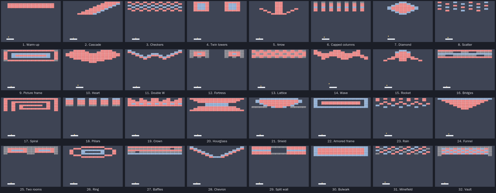

# BRYX

A single-player brick-breaking game in Rust, rendered natively with
`wgpu`. See [`docs/spec.md`](docs/spec.md) for the full design contract.


## Running

```bash
cargo run --release
```

No assets or setup required — it builds and launches straight from a fresh
clone, into a 32-level campaign: simple rows, staircases, frames, columns,
and walls of armored and indestructible bricks. The HUD shows each level's
name. The menu picks what to play: the **Campaign**, **Classic** (the three
levels the game was first specified with, under its first rules), one of
the fetched **Levelsets** (see [Thousands of levels](#thousands-of-levels)),
or a **Shuffle** of ten levels drawn from all of them. ↑/↓ choose the
mode, ←/→ the set, Space plays. `--classic` and `--levelset` open the menu
on that choice.



### 3D renderer (experimental)

An alternate perspective-camera renderer (`src/render3d/`) draws the same
simulation as cubes and a sphere instead of flat quads. It's opt-in behind a
flag until the presentation-3d epic is done, and never changes gameplay —
`src/game.rs`'s physics are identical either way (see the deterministic-replay
test in `game.rs`, pinned to the same hash in both renderers):

```bash
cargo run --release -- --renderer 3d
```


## Autopilot

The game can play itself. With the `typesafe` feature, a TypeSafe System One
model (through the [`judgment`](https://github.com/chussenot/judgment)
crate) picks which part of the wall to attack at every serve and every
paddle hit, and deterministic code flies the paddle to make that shot:

```bash
cargo run --release -- --autopilot                          # heuristic strategy, no network
TYPESAFE_API_KEY=... cargo run --release --features typesafe -- --autopilot
cargo run --release --features typesafe -- --autopilot-every 3   # ask every 3rd paddle hit
```

The model is consulted asynchronously and the game never waits on it. A late,
failed, or unconfident answer falls back to the heuristic.
[`docs/autopilot.md`](docs/autopilot.md) covers the design, the latency
budget, and the measurements.

## Sound

BRYX's music and effects come from the
[Electric Pulse](https://github.com/chussenot/electric-pulse) engine. They
are composed as ABC text in `audio/cues/` and rendered at build time, so
the game runs no C at play time. Bricks broken in a rally climb the E minor
pentatonic scale in time with the music, and every effect is panned to
where it happened. Every campaign level has its own track: 32 in all,
built on three recurring themes across four acts, with loaded levelsets
playing them in a shuffled order. See
[`docs/design/audio.md`](docs/design/audio.md) and the score's guide,
[`docs/design/music.md`](docs/design/music.md).

Building with sound (the default) needs a C compiler and, on Linux, the ALSA
headers (`sudo apt install libasound2-dev`). `cargo run --release
--no-default-features` builds a silent game with neither.
`BRYX_SOUND=effects` or `BRYX_SOUND=off` sets the starting sound mode; M
changes it in game.

## Controls

| Key                | Action                  |
|---------------------|--------------------------|
| Up / Down, W / S    | Menu: choose a mode      |
| Left / Right, A / D | Move the paddle; menu: choose a levelset |
| Space               | Press to launch the ball or release a glued ball; hold to fire a laser |
| Escape (or P)       | Pause / resume           |
| After a Game Over   | Space: continue from the start of the act (level 1, 9, 17 or 25); Escape or P: new game |
| After a Victory     | Space: play again        |
| Q                   | Back to the menu, from the pause and end screens |
| M                   | Sound: on, effects only, off |

Keyboard only; menu and pause screens show the same keys on-screen.

The campaign is four acts of eight levels, and the ball's top speed rises
from 560 to 700 px/s across them. A Game Over continues from the start of
its act with full lives and a fresh score. Your best campaign and
`--classic` scores are kept in a small local file (`$XDG_DATA_HOME/bryx` or
`~/.local/share/bryx` on Linux, `~/Library/Application Support/bryx` on
macOS, `%APPDATA%\bryx` on Windows; `BRYX_DATA_DIR` overrides it); runs
played by `--autopilot` never set them.

Bricks are told apart by pattern as well as color: a plain panel (normal,
one hit), a plate held by four rivets (armored), the same plate cracked
(armored, one hit left), diagonal hatching (indestructible). Set
`BRYX_REDUCED_MOTION=1` to turn off screen and camera shake.

Every impact has its own signature:
- a brick glows from its outline and throws splinters off the struck face;
- an armored brick cracks where it was hit, and later breaks apart along
  that crack;
- an indestructible brick throws back a cold arc;
- an explosive ball's blast reaches its neighbors one by one;
- an asteroid falls apart into rock;
- a metal ball strikes sparks.

The light's color follows the note each broken brick plays. `BRYX_FX=off`,
`geometry` (no bloom or shockwave) or `full` (the default) sets how much of
this runs; `docs/design/kinetic-fx.md` has the design and its costs.

## Design

[`DESIGN.md`](DESIGN.md) is the visual system: one palette
(`src/palette.rs`) and one HUD layer (`src/hud.rs`) shared by both renderers,
a 48 px band above the field so the score never crosses the ball's path, and
JetBrains Mono bundled for the interface. [`PRODUCT.md`](PRODUCT.md) records
who the game is for and the principles behind those choices.

## Capsules and asteroids

A destroyed brick drops a capsule 15% of the time, any of eleven with equal
odds. Catch it with the paddle:

Each capsule is a pill in its own color, with its letter on it, so none
depends on color alone:

| Capsule | Letter | Color | Effect |
|---|---|---|---|
| Widen | W | green | Paddle ×1.5 for 15 s (cancels Tiny) |
| Slow | S | blue | Every ball slows to ×0.7, once, never below launch speed |
| Multiball | M | purple | Two extra balls split off; a life is lost only when the last one drops |
| Glue | G | pink | For 15 s a ball that hits the paddle sticks where it landed; line up and press Space. It leaves at the angle its landing spot gives, or on its own after 3 s |
| Laser | L | red | For 15 s, hold Space to fire twin bolts from the paddle's ends; each bolt gives the first brick it meets one hit |
| Super laser | X | cyan | For 15 s, hold Space to fire one wide bolt that drills through every breakable brick in its column, armored ones included, until an indestructible brick stops it |
| Tiny | T | grey | The one to dodge: paddle ×0.6 for 15 s (cancels Widen) |
| Player | P | gold | One extra life (up to 9) |
| Break | B | orange | Opens a gate at the bottom of the right wall. Slide the paddle out through it to skip to the next level; you score the bricks you skipped, no more. It stays open until you use it, lose a life or the level ends. It never drops on the last level of an act or of a set: finales are played to the last brick |
| Explosive ball | E | chartreuse | For 15 s every ball glows chartreuse and blows up the brick it hits together with the eight around it (armored ones lose a hit); it bounces as usual |
| Metal ball | I | silver | For 15 s every ball turns to steel: it breaks any breakable brick it touches, armored ones included, and flies straight on through. Indestructible bricks still turn it back |

The paddle takes the color of the gun or Glue it carries. Catching one
laser replaces the other.

**Asteroids** (cratered grey-violet rocks, never round like the ball) drift down from the top, over the bricks, wobbling
side to side. A ball that hits one blows it up and bounces off it, which
can send it somewhere you didn't plan. The explosion also breaks the
bricks around it (armored ones take one hit), so hitting one while it
crosses the wall clears a cluster. The paddle and laser bolts blow them up
too. Each is worth 100 points.

`cargo run --release -- --classic` plays as the game was first specified:
Widen, Slow and Multiball only, and no asteroids.

## Thousands of levels

The campaign's 32 levels ship in the binary and need no setup. For
thousands more, fetch the community [LBreakoutHD](https://github.com/midzer/lbreakouthd)
levelset archive with one command:

```bash
scripts/fetch-levelsets.sh
```

This downloads a single pinned upstream commit (checksummed before
anything is extracted), and unpacks it into a gitignored `levels/`
directory as 136 plain-text levelset files, one per named set (e.g.
`levels/Classique`, `levels/Bombs`). It also (re)writes a root-level
`ATTRIBUTION` file crediting every levelset author, as the GPL requires.
Upstream's own "Arkanoid" levelset (a fan recreation of Taito's original
brick layouts) is deliberately never fetched. No new dependency: the
script is plain bash + curl/tar/awk/sha256sum (falling back to `shasum`
where `sha256sum` isn't installed).

**Why isn't this data just in the repo?** LBreakoutHD's levelsets are
GPLv3; this project is MIT. Committing GPL-licensed data alongside MIT
code would saddle the whole repo with the stricter license, so `levels/`
stays out of version control (see `.gitignore` and `ATTRIBUTION`) and the
fetch script is the one-command way to get it onto your own disk instead.

Every set in `levels/` then appears in the menu: highlight **Levelset**
and step through the sets with ←/→, or pick **Shuffle** for ten levels
drawn from all of them. To open the menu on one set, or to offer another
directory's sets, pass `--levelset`:

```bash
cargo run --release -- --levelset levels/Classique
```

A path to one file highlights that set (added to the list if it lives
elsewhere); a path to a directory offers that directory's sets instead of
`levels/`'s.


Twelve of the 3,435 levels in the 136 fetched sets, rendered by this game
(set name and level number under each). The layouts are the LBreakoutHD
levelset authors' work (GPLv3, credited in `ATTRIBUTION`). Regenerate the
image, or render other levels, with `scripts/levelset-mosaic.sh [OUT.png]
[SET:LEVEL ...]` after a release build. It plays each level on
`--autopilot` and screenshots it, so it needs an X display, and starts
Xvfb when there is none.

## Screenshots

Every entity draws from the same `Atlas` layout (`src/assets.rs`); the only
difference between these two runs is where its pixels came from:

```bash
cargo run --release                            # procedural placeholder (default)
scripts/fetch-assets.sh                        # one-time: pulls a CC0 sprite pack
cargo run --release -- --assets assets/pack    # on-disk sprite pack
```

**Procedural vs. pack side-by-side: not captured this session.** The build
machine's display was locked (`swaylock`) for the whole session, so `grim`
only ever captured the lock screen, not the game window — this is a real
placeholder, not a skipped step. Once a session has an unlocked display,
run both commands above, screenshot each window (`grim` on Wayland), and
drop them in as `docs/screenshot-procedural.png` / `docs/screenshot-pack.png`
side by side here.

## Fixed-timestep design

The simulation runs on its own fixed 120 Hz clock (`src/game.rs`'s
`Game::tick`), completely decoupled from the display's refresh rate and from
`wgpu`'s vsync-driven present loop: each real frame, the main loop advances
the simulation by as many 120 Hz ticks as have elapsed (substepping further
within a tick when needed to prevent the ball tunneling through bricks at top
speed), then hands the renderer the previous and current simulation states
along with a leftover fractional-tick `alpha` so `src/render.rs` can linearly
interpolate positions between them — this keeps motion smooth at any monitor
Hz without ever changing gameplay physics, which only ever see fixed
120 Hz steps.

## License

BRYX is MIT-licensed: see [`LICENSE`](LICENSE). Optional third-party data
the fetch scripts download keeps its own license and is never committed;
[`ATTRIBUTION`](ATTRIBUTION) credits it. Two third-party components are
committed:

- the [JetBrains Mono](https://github.com/JetBrains/JetBrainsMono) font in
  `assets/fonts/`, compiled into the game, under the SIL Open Font License
  1.1 (`assets/fonts/OFL.txt`), not MIT;
- the [Impeccable](https://github.com/pbakaus/impeccable) design skill for
  coding agents in `.claude/skills/impeccable/`, Apache-2.0, with its
  `LICENSE` and `NOTICE.md` alongside; it is a development tool, not part
  of the game.
