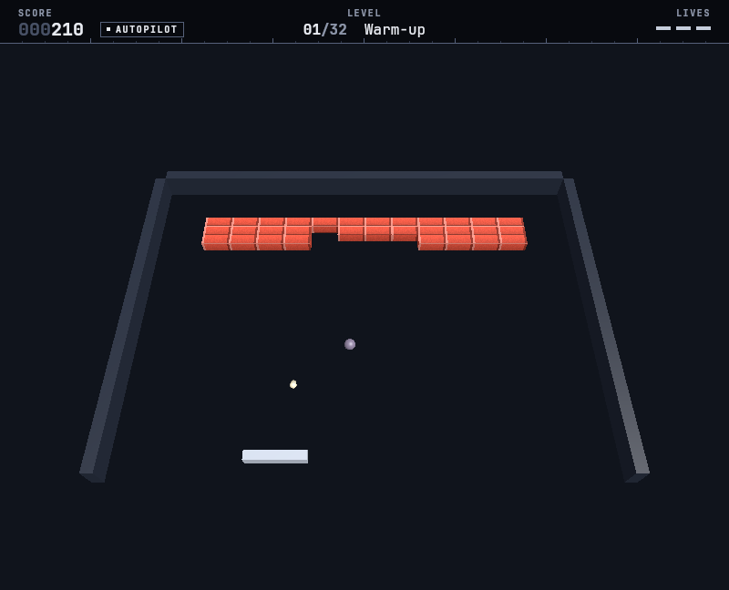
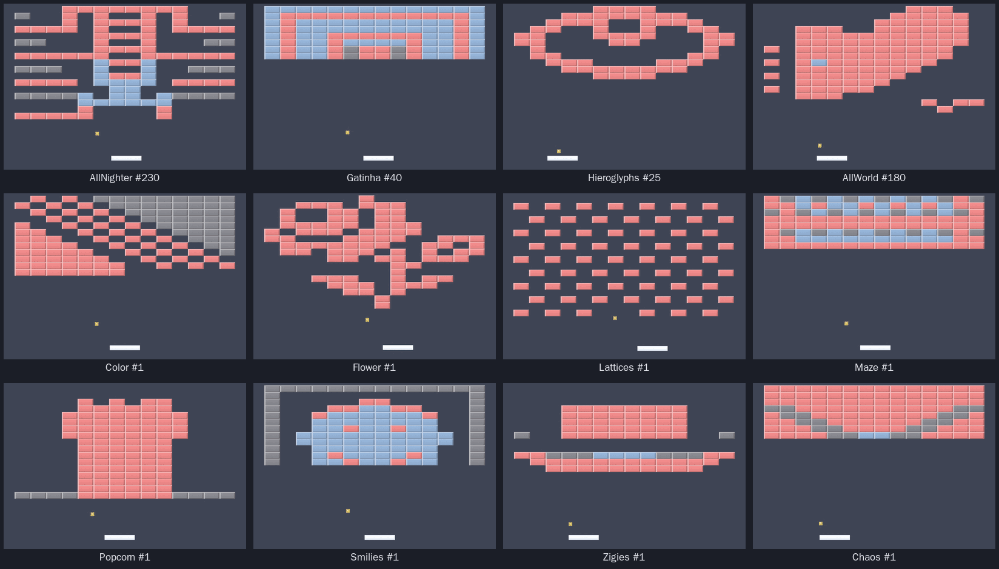

# arkanoid

A single-player Arkanoid/Breakout clone in Rust, rendered natively with
`wgpu`. See [`docs/spec.md`](docs/spec.md) for the full design contract.


## Running

```bash
cargo run --release
```

No assets or setup required — it builds and launches straight from a fresh
clone.

### 3D renderer (experimental)

An alternate perspective-camera renderer (`src/render3d/`) draws the same
simulation as cubes and a sphere instead of flat quads. It's opt-in behind a
flag until the presentation-3d epic is done, and never changes gameplay —
`src/game.rs`'s physics are identical either way (see the deterministic-replay
test in `game.rs`, pinned to the same hash in both renderers):

```bash
cargo run --release -- --renderer 3d
```



## Autopilot

The game can play itself. With the `typesafe` feature, a TypeSafe System One
model (through the [`judgment`](https://github.com/chussenot/judgment)
crate) picks which part of the wall to attack at every serve and every
paddle hit, and deterministic code flies the paddle to make that shot:

```bash
cargo run --release -- --autopilot                          # heuristic strategy, no network
TYPESAFE_API_KEY=... cargo run --release --features typesafe -- --autopilot
cargo run --release --features typesafe -- --autopilot-every 3   # ask every 3rd paddle hit
```

The model is consulted asynchronously and the game never waits on it. A late,
failed, or unconfident answer falls back to the heuristic.
[`docs/autopilot.md`](docs/autopilot.md) covers the design, the latency
budget, and the measurements.

## Controls

| Key                | Action                  |
|---------------------|--------------------------|
| Left / Right, A / D | Move the paddle          |
| Space               | Launch the ball; press to release a glued ball; hold to fire a laser |
| Escape (or P)       | Pause / resume           |

Keyboard only; menu and pause screens show the same key hints on-screen.

## Capsules and asteroids

A destroyed brick drops a capsule 15% of the time, any of seven with equal
odds. Catch it with the paddle:

| Capsule | Color | Effect |
|---|---|---|
| Widen | green | Paddle ×1.5 for 15 s (cancels Tiny) |
| Slow | blue | Every ball slows to ×0.7, once, never below launch speed |
| Multiball | purple | Two extra balls split off; a life is lost only when the last one drops |
| Glue | pink | For 15 s a ball that hits the paddle sticks where it landed; line up and press Space. It leaves at the angle its landing spot gives, or on its own after 3 s |
| Laser | red | For 15 s, hold Space to fire twin bolts from the paddle's ends; each bolt gives the first brick it meets one hit |
| Super laser | cyan | For 15 s, hold Space to fire one wide bolt that drills through every breakable brick in its column, armored ones included, until an indestructible brick stops it |
| Tiny | grey | The one to dodge: paddle ×0.6 for 15 s (cancels Widen) |

The paddle takes the color of the gun or Glue it carries. Catching one
laser replaces the other.

**Asteroids** (orange) drift down from the top, over the bricks, wobbling
side to side. A ball that hits one blows it up and bounces off it, which
can send it somewhere you didn't plan. The explosion also breaks the
bricks around it (armored ones take one hit), so hitting one while it
crosses the wall clears a cluster. The paddle and laser bolts blow them up
too. Each is worth 100 points.

`cargo run --release -- --classic` plays as the game was first specified:
Widen, Slow and Multiball only, and no asteroids.

## Thousands of levels

Three built-in levels ship in the binary and need no setup. For
thousands more, fetch the community [LBreakoutHD](https://github.com/midzer/lbreakouthd)
levelset archive with one command:

```bash
scripts/fetch-levelsets.sh
```

This downloads a single pinned upstream commit (checksummed before
anything is extracted), and unpacks it into a gitignored `levels/`
directory as 136 plain-text levelset files, one per named set (e.g.
`levels/Classique`, `levels/Bombs`). It also (re)writes a root-level
`ATTRIBUTION` file crediting every levelset author, as the GPL requires.
Upstream's own "Arkanoid" levelset (a fan recreation of Taito's original
brick layouts) is deliberately never fetched. No new dependency: the
script is plain bash + curl/tar/awk/sha256sum (falling back to `shasum`
where `sha256sum` isn't installed).

**Why isn't this data just in the repo?** LBreakoutHD's levelsets are
GPLv3; this project is MIT. Committing GPL-licensed data alongside MIT
code would saddle the whole repo with the stricter license, so `levels/`
stays out of version control (see `.gitignore` and `ATTRIBUTION`) and the
fetch script is the one-command way to get it onto your own disk instead.

Point the game at a fetched set with `--levelset`:

```bash
cargo run --release -- --levelset levels/Classique
```

A path to one file loads that set; a path to a directory (e.g.
`--levelset levels/` for everything you fetched) lists every set found.
Once a set is loaded, the in-game menu also offers **RANDOM10**: instead
of playing a set's full level list top to bottom, it samples 10 random
levels from it for a quicker session. Either way, completion is tracked
per set, keyed by the same path you passed to `--levelset`.



Twelve of the 3,435 levels in the 136 fetched sets, rendered by this game
(set name and level number under each). The layouts are the LBreakoutHD
levelset authors' work (GPLv3, credited in `ATTRIBUTION`). Regenerate the
image, or render other levels, with `scripts/levelset-mosaic.sh [OUT.png]
[SET:LEVEL ...]` after a release build. It plays each level on
`--autopilot` and screenshots it, so it needs an X display, and starts
Xvfb when there is none.

## Screenshots

Every entity draws from the same `Atlas` layout (`src/assets.rs`); the only
difference between these two runs is where its pixels came from:

```bash
cargo run --release                            # procedural placeholder (default)
scripts/fetch-assets.sh                        # one-time: pulls a CC0 sprite pack
cargo run --release -- --assets assets/pack    # on-disk sprite pack
```

**Procedural vs. pack side-by-side: not captured this session.** The build
machine's display was locked (`swaylock`) for the whole session, so `grim`
only ever captured the lock screen, not the game window — this is a real
placeholder, not a skipped step. Once a session has an unlocked display,
run both commands above, screenshot each window (`grim` on Wayland), and
drop them in as `docs/screenshot-procedural.png` / `docs/screenshot-pack.png`
side by side here.

## Fixed-timestep design

The simulation runs on its own fixed 120 Hz clock (`src/game.rs`'s
`Game::tick`), completely decoupled from the display's refresh rate and from
`wgpu`'s vsync-driven present loop: each real frame, the main loop advances
the simulation by as many 120 Hz ticks as have elapsed (substepping further
within a tick when needed to prevent the ball tunneling through bricks at top
speed), then hands the renderer the previous and current simulation states
along with a leftover fractional-tick `alpha` so `src/render.rs` can linearly
interpolate positions between them — this keeps motion smooth at any monitor
Hz without ever changing gameplay physics, which only ever see fixed
120 Hz steps.

