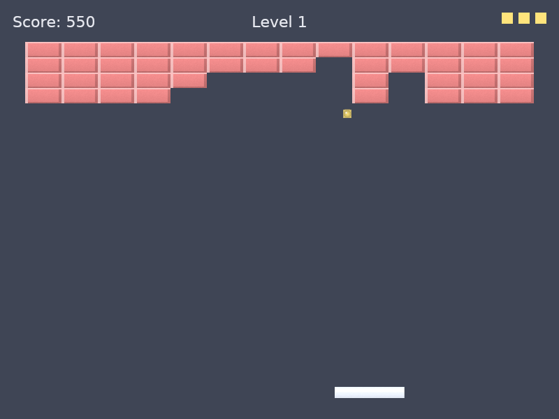

# Autopilot

`--autopilot` makes the game play itself. It produces the same `Input` a
keyboard would, one 120 Hz tick at a time, so `game.rs` doesn't know it
exists. Built with `--features typesafe`, the shot strategy comes from a
TypeSafe System One model, called through the
[`judgment`](https://github.com/chussenot/judgment) crate.

```bash
cargo run --release -- --autopilot                                  # heuristic strategy, no network
TYPESAFE_API_KEY=... cargo run --release --features typesafe -- --autopilot
cargo run --release --features typesafe -- --autopilot-every 3      # consult the model every 3rd paddle hit
```

Escape/P still pauses. Every model decision is printed as one line, and a
summary of the whole session is printed when the window closes:

```text
autopilot: #14 level 1 -> left (confidence 0.36, 137 ms): used
autopilot: #15 level 1 -> left (confidence 0.29, 157 ms): below the confidence bar, heuristic kept
```



## Two layers: the model plans, code flies

| Layer | Decides | How often | Where |
|---|---|---|---|
| **Strategy** | which of five 160 px lanes to attack next | at every serve, and every N paddle hits (`--autopilot-every N`, default 1) | `src/autopilot/advisor.rs` (model) or `board.rs` (heuristic) |
| **Piloting** | where the ball meets the paddle, which hit offset sends it to the lane, when to release a glued ball, whether a power-up catch is safe | every tick | `src/autopilot/pilot.rs`, `game::forecast_crossing` |

Where the ball will meet the paddle comes from `game::forecast_crossing`.
It runs the ball forward tick by tick through the simulation's own
collision functions: walls, bricks (which break or lose a hit as they
would) and asteroids (which drift, blow up and break the bricks around
them as they would). The forecast
is replayed a tick at a time while the ball stays on it, and recomputed
only when something it left out happens (the paddle, a new asteroid,
another ball breaking a brick first), so it costs about one simulation per
rally. A ball still among the bricks after three seconds gets a
straight-line guess, and the pilot aims only on an exact forecast. This
replaced a straight-line estimate that ignored bricks. On level 3, where
the ball rattles around inside the box before dropping out of the gate,
that estimate sent the paddle after phantom landings, and it was where
nearly every life was lost.

A glued ball leaves with the velocity its paddle hit already gave it, from
wherever the paddle carries it. The pilot moves the paddle so that launch
point and angle line up with the target, then presses Space. If another
ball is in flight it releases at once, because the paddle is needed under
that one.

With a Laser or Super laser it holds Space the whole time the ball is in
flight: a bolt can only help. A glued ball's release takes precedence,
since that needs a press. It never chases a Tiny capsule, the one that
shrinks the paddle, though it doesn't dodge one either. An open Break
gate beats any catch: it heads out through it whenever it can be all the
way through 0.2 s before the next ball reaches the paddle, since leaving
the level that way skips every brick left.

The model is never asked to move the paddle. Moving it is geometry the
simulation already defines: where a ball crosses the paddle line (walls
included), and how a hit offset maps to an exit angle. The pilot inverts
that mapping with `game.rs`'s own `offset_to_exit_angle_deg`, not a copy of
it. A model would answer this more slowly, less accurately, and at a cost.
What the model *is* asked is the one question with no closed-form answer:
which part of the wall is worth attacking. That is one atomic Choice over
five lanes, the shape System One is built for.

Facts go to the model as data, not as questions. The state it gets is the
brick map (`.`, `1`, `2`, `X`, one character per 50 px column), per-lane
counts (`destructible`, `exposed` to a straight shot, `indestructible`),
the balls, the paddle, lives, level, and `rallies_without_progress`.

## Why a decision per rally, and why the game never waits

A rally (paddle to wall and back) takes at least ~0.9 s at the 700 px/s
speed cap. The hosted API answered in 174 ms on average (749 ms worst, on
a cold connection) across 141 calls. So a consultation goes out the moment
the ball leaves the paddle, and its answer is back long before the ball
returns.

The game loop never blocks on it. `judgment` is async, so the client runs
on its own worker thread with a single-threaded tokio runtime
(`advisor::Background`). Each tick polls a channel. A stale request is
dropped in favor of the newest one, and a call that hasn't finished after
2.5 s is abandoned (1.5 s per attempt, at most one retry). A serve waits up
to 1.5 s for its first answer and then launches anyway.

## When a model answer is used

A model answer is a preference, never a command. It is used only if it:

1. answers the latest request (late replies are counted and dropped),
2. names a lane that still has bricks (`Response::verify` already rejects
   a lane that wasn't offered), and
3. has confidence ≥ 0.3. TypeSafe's Choice confidence over five options is
   `(p_max − 0.2) / 0.8`, so 0.3 means the top lane holds at least 44% of
   the probability.

Otherwise the deterministic pick stands: the lane with the most exposed and
remaining bricks, nearest the middle on a tie. After four paddle hits in a
row with no brick broken, the shot is looping (typically between
indestructible bricks and the paddle). The autopilot then overrides the
model's lane, sets its answers aside until a brick breaks, and sweeps its
aim across the whole field in golden-ratio steps until something does. The
last bricks of a level are often reachable only by a bank shot no lane
target describes, and an aim this precise would otherwise replay the same
few trajectories. A ball caught in an orbit no shot can reach (inside level
3's box, say) is the game's job, not the pilot's: the spec's stall-breaking
rule turns it a few degrees per bounce after 10 s without progress. Setting the answers aside matters on level 3, whose
bricks are reached only through a gate in its indestructible floor. A model
that keeps naming a lane behind the wall would otherwise put the shot back
into the loop on its very next answer. The consequence: the game plays the
same with no key, no network, or a slow model. The model can only change
where the shots go.

## Measured

Heuristic only, 20 seeds per feature set, the three built-in levels
(`cargo test --release -- --ignored --nocapture benchmark_`):

| Features | Won | Lives lost (total over 20 games) | Game time to win, mean / max |
|---|---|---|---|
| v1 (`--classic`) | 20/20 | 1 | 406 s / 480 s |
| Glue only | 20/20 | 2 | 438 s / 600 s |
| Asteroids only | 20/20 | 3 | 414 s / 524 s |
| Laser and Super laser only | 20/20 | 0 | 321 s / 601 s |
| Tiny only | 20/20 | 2 | 413 s / 614 s |
| Player and Break only | 20/20 | 1 | 326 s / 469 s |
| Everything (default) | 20/20 | 1 | 293 s / 483 s |

Before the exact forecast and stall breaking, the same benchmark lost
27–40 lives per feature set and won 12–18 of 20.

| Model run | Three built-in levels won in | Lives lost | Consultations |
|---|---|---|---|
| `jev-latest`, seed 42, v1 rules, blocking | 403 s | 0 | 277: 146 used, 32 below the bar, 111 set aside while looping, 0 failed; 139 ms mean |
| `jev-latest`, seed 42, Glue and asteroids on (blasts included), exact forecast, blocking | 480 s | 0 | 293: 162 used, 60 below the bar, 84 set aside while looping, 0 failed; 133 ms mean |

Read the model runs as a working integration, not as proof that the model
plays better. Each is one run, and in both a good share of answers named
a lane the shot could not reach through level 3's gate (111 and 84), which
the loop override caught. To
compare them properly, run both over many seeds and look at the spread.
The live test below is the harness for that.

## Tests

Every test is headless and runs in CI. The `typesafe` ones use
`judgment::Fake` and never call a real API.

- `pilot.rs`: intercept prediction through walls and the ceiling, aim
  checked against the simulation's own angle mapping, steering deadband.
- `board.rs`: lane counts, exposure behind indestructible bricks, the map.
- `mod.rs`: the heuristic wins the three built-in levels with every
  addition on, on three seeds, and the whole fixture levelset. It aims and
  releases glued balls itself rather than waiting out the hold limit,
  fires a gun, goes for a Widen but not a Tiny, and takes an open Break
  gate only when the ball leaves it the time. A confident model lane
  is used, and a model
  stuck on an unreachable lane is set aside while it loops; a model below
  the bar never is; a silent model delays serves but never stops the game;
  `--autopilot-every` spaces out consultations.
- `advisor.rs`: the question's shape and lane order, the state, a `Fake`
  answer read back, an off-list lane being an error, the worker thread, and
  a full game through the real advisor.

Against the real API, by hand (needs `TYPESAFE_API_KEY`):

```bash
cargo test --features typesafe -- --ignored --nocapture live_
```
