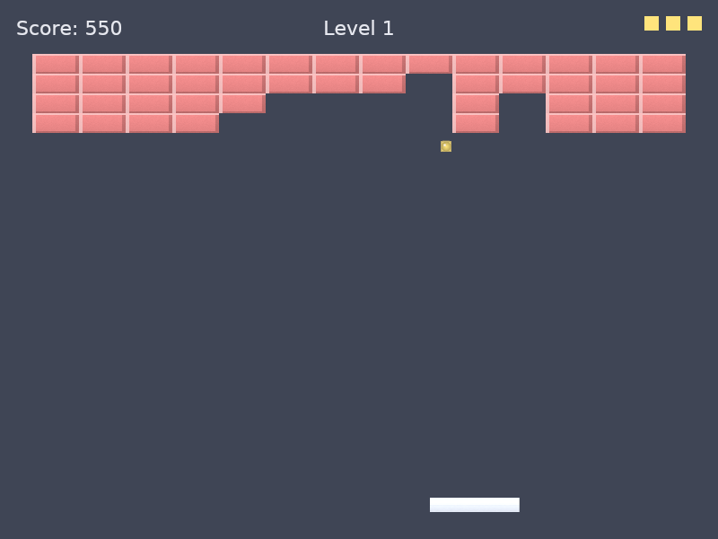

# Autopilot

`--autopilot` makes the game play itself. It produces the same `Input` a
keyboard would, one 120 Hz tick at a time, so `game.rs` doesn't know it
exists. Built with `--features typesafe`, the shot strategy comes from a
TypeSafe System One model, called through the
[`judgment`](https://github.com/chussenot/judgment) crate.

```bash
cargo run --release -- --autopilot                                  # heuristic strategy, no network
TYPESAFE_API_KEY=... cargo run --release --features typesafe -- --autopilot
cargo run --release --features typesafe -- --autopilot-every 3      # consult the model every 3rd paddle hit
```

Escape/P still pauses. Every model decision is printed as one line, and a
summary of the whole session is printed when the window closes:

```text
autopilot: #14 level 1 -> left (confidence 0.36, 137 ms): used
autopilot: #15 level 1 -> left (confidence 0.29, 157 ms): below the confidence bar, heuristic kept
```



## Two layers: the model plans, code flies

| Layer | Decides | How often | Where |
|---|---|---|---|
| **Strategy** | which of five 160 px lanes to attack next | at every serve, and every N paddle hits (`--autopilot-every N`, default 1) | `src/autopilot/advisor.rs` (model) or `board.rs` (heuristic) |
| **Piloting** | where the ball meets the paddle, which hit offset sends it to the lane, whether a power-up catch is safe | every tick | `src/autopilot/pilot.rs` |

The model is never asked to move the paddle. Moving it is geometry the
simulation already defines: where a ball crosses the paddle line (walls
included), and how a hit offset maps to an exit angle. The pilot inverts
that mapping with `game.rs`'s own `offset_to_exit_angle_deg`, not a copy of
it. A model would answer this more slowly, less accurately, and at a cost.
What the model *is* asked is the one question with no closed-form answer:
which part of the wall is worth attacking. That is one atomic Choice over
five lanes, the shape System One is built for.

Facts go to the model as data, not as questions. The state it gets is the
brick map (`.`, `1`, `2`, `X`, one character per 50 px column), per-lane
counts (`destructible`, `exposed` to a straight shot, `indestructible`),
the balls, the paddle, lives, level, and `rallies_without_progress`.

## Why a decision per rally, and why the game never waits

A rally (paddle to wall and back) takes at least ~0.9 s at the 700 px/s
speed cap. The hosted API answered in 174 ms on average (749 ms worst, on
a cold connection) across 141 calls. So a consultation goes out the moment
the ball leaves the paddle, and its answer is back long before the ball
returns.

The game loop never blocks on it. `judgment` is async, so the client runs
on its own worker thread with a single-threaded tokio runtime
(`advisor::Background`). Each tick polls a channel. A stale request is
dropped in favor of the newest one, and a call that hasn't finished after
2.5 s is abandoned (1.5 s per attempt, at most one retry). A serve waits up
to 1.5 s for its first answer and then launches anyway.

## When a model answer is used

A model answer is a preference, never a command. It is used only if it:

1. answers the latest request (late replies are counted and dropped),
2. names a lane that still has bricks (`Response::verify` already rejects
   a lane that wasn't offered), and
3. has confidence ≥ 0.3. TypeSafe's Choice confidence over five options is
   `(p_max − 0.2) / 0.8`, so 0.3 means the top lane holds at least 44% of
   the probability.

Otherwise the deterministic pick stands: the lane with the most exposed and
remaining bricks, nearest the middle on a tie. After four paddle hits in a
row with no brick broken, the shot is looping (typically between
indestructible bricks and the paddle). The autopilot then overrides the
model and rotates lanes until something breaks. The consequence: the game
plays the same with no key, no network, or a slow model. The model can only
change where the shots go.

## Measured

| Run | Levels 1+2 cleared in | Lives lost | Consultations |
|---|---|---|---|
| Heuristic, seeds 1/3/5/7/9/11/42 | 195–251 s of game time | 0–1 | — |
| `jev-latest`, seed 42, blocking | 256 s | 1 | 141: 102 used, 39 below the bar, 0 failed |
| Heuristic, seed 42 | 207 s | 0 | — |

Read this as a working integration, not as proof that the model plays
better. On one seed, the model-steered run was slower than the heuristic.
This game's strategy space is small and the heuristic already sees what
matters. To actually compare them, run both over many seeds and look at the
spread, not one run each. The live test below is the harness for that.

## Tests

Every test is headless and runs in CI. The `typesafe` ones use
`judgment::Fake` and never call a real API.

- `pilot.rs`: intercept prediction through walls and the ceiling, aim
  checked against the simulation's own angle mapping, steering deadband.
- `board.rs`: lane counts, exposure behind indestructible bricks, the map.
- `mod.rs`: the heuristic clears built-in levels 1 and 2 on three seeds and
  wins the whole fixture levelset. A confident model lane is used; a model
  below the bar never is; a silent model delays serves but never stops the
  game; `--autopilot-every` spaces out consultations.
- `advisor.rs`: the question's shape and lane order, the state, a `Fake`
  answer read back, an off-list lane being an error, the worker thread, and
  a full game through the real advisor.

Against the real API, by hand (needs `TYPESAFE_API_KEY`):

```bash
cargo test --features typesafe -- --ignored --nocapture live_
```

## Known limit: built-in level 3 can't be cleared

Level 3's breakable bricks sit inside a closed box of indestructible ones:
the top and bottom rows are all `X`, and every row in between starts and
ends with `X`. No shot can get in, autopilot or human. So the tests hold
the autopilot to levels 1 and 2 plus a whole external set. Opening a gap in
level 3 means changing `levels.rs` and the spec's level design, which is a
separate decision.
