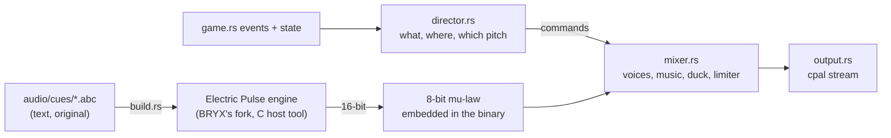

# BRYX audio

The sound of BRYX: what it is, how it is made, and why. Owned by the Audio
Director / Sound Designer role of the [director review](director-review.md);
this closes the review's highest-value open item.

## Identity

BRYX sounds like a sibling of
[Electric Pulse](https://github.com/chussenot/electric-pulse): the same
engine, the same dark-synth chip voice (pulse, triangle and noise
oscillators, ADSR, drive, ladder filter, delay, sidechain). DESIGN.md's "Measured Field"
carries over to sound: precise, synthetic, warm, never a nostalgic replica
of any arcade machine. Every note and loop is original.

Four ideas shape everything below:

1. **The field plays in key.** The music is in E minor. Each brick
   broken in a rally sounds the next note up the E minor pentatonic scale
   (E, G, A, B, D, E…), and the paddle sends it back to the root. A good
   rally plays a phrase over the beat. A bad one plays one note.
2. **Sound sits where it happens.** Every effect is panned, with equal
   power, to its x on the field, three quarters of the way to each
   speaker. This holds in both renderers.
3. **The paddle tightens with the ball.** Its knock rises up to a minor
   third as the ball climbs from 300 to 700 px/s, so the rally's pace is
   heard.
4. **Music follows the campaign.** Every campaign level has its own track,
   32 in all plus a menu theme, built from three recurring themes (Ascent,
   the Wall, Spark) across four acts. The score has its own guide:
   [`music.md`](music.md). Loaded levelsets play the score in a shuffled
   order drawn each session. Stingers mark the moments (life lost, level
   cleared, Game Over, Victory, 1UP) and duck the music beneath them.

## How it is built

- **Render at build time, not at runtime.** `build.rs` compiles the
  engine (`audio/engine/`, BRYX's fork: see its PROVENANCE.md) and
  `audio/render.c` into a host tool, then renders each cue to 16-bit PCM
  and encodes it to mu-law in `OUT_DIR`; the binary embeds the bytes. The game runs no C and no
  `unsafe` FFI, needs no audio files beside it, and every build sounds the
  same. A sound is an `.abc` text file: edit it, rebuild, hear it.
- **One renderer, many notes.** Pitch is playback rate, so one rendered
  brick note plays the whole pentatonic scale and one paddle knock every
  speed.
- **Playback through `cpal`**, the backend Electric Pulse chose for direct
  playback (its ADR-0001). It is a device layer only; the mixer is BRYX's
  own, in `src/audio/mixer.rs`:
  - up to 32 voices, the oldest stolen beyond that;
  - music crossfades over 1.2 s;
  - stingers duck the music to 25%;
  - a `tanh` soft limiter, so a burst of breaks never hard-clips.
- **The game thread never blocks on audio.** Commands cross a channel;
  the callback drains it and owns the mixer.
- **Presentation only.** The director reads each tick's events before
  `main.rs` drains them, plus the game's state, exactly as the renderers
  do. Nothing in `src/audio/` can change what happens; the pinned replay
  hash is untouched.

## The engine fork

BRYX began with Electric Pulse's engine unmodified. Writing the score
exposed three rendering problems that no composition could fix, so BRYX
forked the engine (`audio/engine/PROVENANCE.md` lists every change):
- **Voices rendered at 3–5 bits.** The engine synthesized each voice in
  8-bit output steps and truncated every envelope and effect multiply.
  Once mastered, the pad swung ±3 steps, and the arpeggio and counter ±4.
  A quiet voice also lost level to the rounding: one at amplitude 10
  rendered 4.9 dB below what was written. The fork mixes at 16-bit scale
  and quantizes once. Measured on every cue, a file that uses no new
  directive renders the same at high level and correctly at low level.
- **No held notes.** Every sixteenth-note step struck a new note, so `E16`
  was sixteen attacks. Pads never finished their attack, vibrato
  restarted every step, and long notes were never long. With `%%hold on`
  (every track and stinger), a written note sounds once.
- **Buses that could not filter, and a pump on everything.** Every effect
  bus added a processed copy beside the dry signal, so a lowpass could not
  darken anything. The arpeggio's sidechain ducked the whole mix on every
  beat, drums included. The fork adds insert buses and a sidechain keyed
  by the kick that ducks only its own bus. The score uses both: the
  machine tracks' ladder filter is an insert, and the arpeggio pumps to
  the kick.

The fork also lets ABC reach instrument features the mixer always had:
- stacked, detuned oscillators;
- pulse-width sweeps;
- vibrato rate and a vibrato that fades in;
- accent gain.

Rebalancing kept every voice near its level in the first version of the
score, measured soloed track by track; most land within about 1.5 dB, with
a few track-specific outliers (Fortress's hat, the soft pad). The stingers
hold their notes and keep their loudness within about 2 dB.

**Phase 2: expression.** The score now uses the fork's second round:
- **Dynamics.** Each section has a level: the recap is the loudest, the
  break the softest, and the bar before the recap swells beat by beat.
  The hats' off-beats sit above their sixteenths, the kick leans on each
  downbeat, and ghost snares sit under the recap. Melodic voices accent
  only where marked: the lead's phrase starts and peaks.
- **Drums.**
  - A pitch-swept triangle kick: two octaves down to E2 in 55 ms.
  - A clocked-noise snare that drops an octave as it sounds.
  - A metallic hat from the short LFSR.
- **Triads.** Pads hold whole voice-led triads. The pad amplitudes came
  down about 4.6 dB, so three notes sit where one did.
- **Automation.**
  - The machine tracks' ladder filter opens across B, closes in the
    break and reopens into the recap.
  - The melody's echo swells in the break and is thrown at the turn.
  - The pulse leads narrow toward the climax.

Rebalanced against the phase 1 score, voice by voice, every voice lands
within about 1.5 dB. Each track's quietest bar now sits a median 13.1 dB
under its loudest, against 9.8 before. Every track still masters to
-19.0 dBFS, and the in-game mix measures as before. Nine probe tests in
`src/audio/probes.rs` check the fork's features on what it renders.

**Phase 3: room, tempo and the seam.**
- **Seamless loops.** Every track was rendered once, from silence, so at
  each loop restart its echoes, reverb and release tails were cut and the
  first bar played dry. Measured against the same music played
  continuously, the seam was only 10–19 dB under the signal. `%%loop`
  renders twice and keeps the second pass, and the seam now matches
  continuous playback exactly (bit for bit on Warm-up and Bridges, 79 dB
  under on Fortress).
- **Band-limited oscillators.** PolyBLEP on every square and pulse in the
  score cuts the inharmonic aliasing of high notes by 25–42 dB.
- **Reverb.** A small room on the melody bus: light on the clean tracks,
  larger on the space tracks, opening in the break; the machine tracks
  stay dry.
- **Tempo.** Funnel and Rocket push forward through B and settle back in
  the break. Game Over slows into its last E; Victory broadens into its
  major chord.
- **Toms.** A ninth voice, past the old limit of eight: the rolls into
  the recap end on toms, high to low.

Rebalanced against phase 2, every voice lands within about 2 dB, except
Vault's lead (+3 dB, mostly reverb on a busy line).

**The sound pass.** Every effect and stinger was rewritten with the
fork's features: pitch sweeps instead of glides, clocked and metal noise
instead of white, dynamics, chords, reverb and band-limiting where they
serve the sound. The laser keeps its hard edges on purpose: the grit is
the zap. Each cue keeps its role, its base pitch (brick and paddle are
still pitched by the director) and its loudness:
- Over the old sound's length, every cue is within 0.6 dB of before
  except Victory, at -0.8 dB (held by its 0.9 peak cap).
- No cue peaks above 0.9.
- The reverb tails lengthen Warp (to 1.0 s) and Explosion (to 0.56 s).

**Storage: mu-law.** Linear 8-bit storage would throw the 16-bit render
away again: in the score's quietest bars (median -28 dBFS) it leaves the
signal 25 dB above its noise. G.711 mu-law spends the same byte
logarithmically, so those bars keep 37 dB. The embedded audio stays about
22 MB. `src/audio/mulaw.rs` is the one codec: `build.rs` includes it to
encode, and the mixer decodes it through a 256-entry table.

## Cues

| Cue | When | Sound |
|---|---|---|
| `brick` | a brick breaks | a pulse pop that snaps down onto its note, with a glint of metal noise; pitched up the scale by the rally |
| `armor` | an armored brick cracks | two metallic tinks, the second softer, over ringing metal noise |
| `paddle` | ball meets paddle | a triangle knock that drops a fourth onto its note, and a clocked-noise click; pitched by speed |
| `launch` | serve | one note whipping up two octaves, over a rising breath of noise |
| `capsule` | any helpful capsule | a quick rising arpeggio that swells into its top, with an echo |
| `tiny` | the Tiny capsule | a falling arpeggio that fades as it shrinks, its pulse width wobbling sour |
| `oneup` | the Player capsule | a small fanfare landing on a two-note chord, in a little room; ducks the music |
| `laser`, `superlaser` | a gun fires | a note falling two octaves in 60 ms; a square falling three, with a buzz and a falling hiss |
| `asteroid` | an asteroid arrives | a low clocked-noise rumble swelling in over a wavering drone |
| `explosion` | an asteroid blows up | a noise burst whose clock falls three octaves (crack, then rumble), over a thump dropping a fifth, in a little room |
| `ball_lost` | one ball of a multiball drops | a descending figure that fades as it falls |
| `warp` | leaving through the Break gate | one note rising three octaves over a rising rush of noise, into an echoing room |
| `select`, `pause` | start, continue, resume; pause | two-note blips, up (the second leaning in) and down (the second stepping back) |
| `life_lost`, `level_clear`, `game_over`, `victory` | stingers | the score's themes in miniature ([`music.md`](music.md#stingers)) |
| `music_menu`, `music_01`–`32` | loops | the score: see [`music.md`](music.md) |

## Mix

| | Level |
|---|---|
| Music | 0.52 under the effects; 0.3 of that while paused; 25% under a stinger |
| Bricks, paddle | 0.6–0.65 |
| Other effects | 0.3–0.7, by importance |
| Master | 1.5 into the soft limiter |

Measured on 40 s autopilot soundtracks, rendered offline through the same
director and mixer: about -19.5 dBFS RMS with peaks near -3 dBFS, the same
on levels 1 and 22, and no sample at full scale. The engine fork moved
these by about half a decibel. The score itself is mastered to -19.0 dBFS,
track for track ([`music.md`](music.md)).

## Player control and accessibility

- **M** cycles the sound: on, effects only, off. The menu and pause
  screens show the current setting beside the key.
- `BRYX_SOUND=effects` or `BRYX_SOUND=off` sets the starting mode.
- No device (a headless machine) means one warning and a silent game,
  never a crash.
- Every cue has a visual counterpart, so no information is sound-only.

## Building

- The default `audio` feature needs a C compiler (any `cc` finds), and on
  Linux the ALSA headers (`libasound2-dev`); CI installs them.
- `--no-default-features` builds a silent game with neither.

## Open

- **Spatial depth.** Sound is panned left to right only. In the 3D
  renderer, a little low-pass for the far side of the field would add
  depth.
- **Longer forms.** Each level loops a 16-bar track of 27–36 s. A longer
  form, or a B-side per level, would cost about 0.7 MB of binary per
  track.
- **Tuplets.** The engine's grid is the sixteenth note, so a triplet
  would need a finer grid for the whole song (`audio/engine/PROVENANCE.md`).
- **Longer forms.** The engine now reaches 256 bars a track. What a longer
  form costs is binary size, about 0.7 MB per 16 bars per track.
- **A listening pass.** Every level and loudness figure here was measured
  in a headless environment with no speakers. Please play it on real
  speakers and headphones; the mix constants live in `mixer.rs` and
  `director.rs`.
