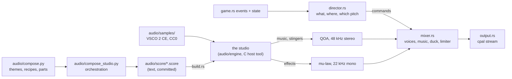

# BRYX audio

The sound of BRYX: what it is, how it is made, and why. Owned by the Audio
Director / Sound Designer role of the [director review](director-review.md).

This page describes the game as it plays. How the score got here is in
[`orchestral-score.md`](orchestral-score.md) (the design and its phases),
[`studio-report.md`](studio-report.md) (the engine, measured) and
[`reference-cues.md`](reference-cues.md) (the listening gate). The score
itself has its own guide: [`music.md`](music.md).

## Identity

A mechanical, futuristic arcade score with orchestral scale: human
orchestral expression set against machine-precise electronic repetition.
Dark, rhythmic without being dance music, melodic first. A sampled
orchestra (strings, brass, timpani, percussion) plays with analog-style
synths (a saw bass, a sequence, pads, a bell). Every note is original.

Four ideas shape everything below:

1. **The field plays in key.** The music is in E minor. Each brick
   broken in a rally sounds the next note up the E minor pentatonic scale
   (E, G, A, B, D, E…), and the paddle sends it back to the root. The
   seventh is the playing track's own: D sharp over the harmonic-minor
   tracks, which never play a D. The tenth step is the tonic, two octaves
   up, so a long rally holds the home note. A good rally plays a phrase
   over the beat. A bad one plays one note. A blast is a ripple, not a
   chord: each brick it breaks or cracks sounds when the blast's front
   reaches it (`src/cadence.rs`), the moment its light starts.
2. **Sound sits where it happens.** Every effect is panned, with equal
   power, to its x on the field, three quarters of the way to each
   speaker. This holds in both renderers.
3. **The paddle tightens with the ball.** Its knock rises up to a minor
   third as the ball climbs from 300 to 700 px/s, so the rally's pace is
   heard.
4. **Music follows the campaign.** Every campaign level has its own track,
   32 in all plus a menu theme, built from three recurring themes (Ascent,
   the Wall, Spark) across four acts, each act with its own orchestra and
   its own level. Loaded levelsets play the score in a shuffled order
   drawn each session. Stingers mark the moments (life lost, level
   cleared, act cleared, Game Over, Victory, 1UP) and duck the music
   beneath them.

## How it is built

- **Render at build time, not at runtime.** `build.rs` compiles the studio
  (`audio/engine/`: see its PROVENANCE.md) and `audio/render.c` into a host
  tool and renders every score in `OUT_DIR`; the binary embeds the bytes.
  The game runs no C and no `unsafe` FFI, needs no audio files beside it,
  and every build on a machine sounds the same. A sound is a `.score` text
  file.
- **The studio** renders a score in 32-bit float stereo at 48 kHz:
  - a sampler playing a curated, CC0 subset of VSCO 2 Community Edition
    (`audio/samples/`), with velocity layers and looped sustains;
  - an analog-style synth voice (band-limited oscillators, stacks, a
    ladder filter, envelopes, LFOs);
  - group buses with EQ and keyed compressors, four reverbs and a
    ping-pong echo on aux returns, a master compressor and limiter.

  Named instruments and the mixing desk live in `audio/instruments/`.
- **Two storage formats, one per job:**
  - **Music and stingers: QOA**, 48 kHz stereo, 3.2 bits a sample
    (`src/audio/qoa.rs`, a port of the reference decoder, checked bit for
    bit). The mixer decodes one 20-sample slice at a time as a track plays
    and resamples to the device's rate with a cubic. A loop is encoded
    with the predictor state its own end leaves, so it wraps without a
    click.
  - **Effects: 8-bit mu-law**, mono at 22,050 Hz (`src/audio/mulaw.rs`).
    They are short, mono by nature (the game pans them) and pitched by
    playback rate, which needs random access QOA does not give.
- **One renderer, many notes.** Pitch is playback rate, so one rendered
  brick note plays the whole pentatonic scale and one paddle knock every
  speed.
- **Playback through `cpal`.** It is a device layer only; the mixer is
  BRYX's own, in `src/audio/mixer.rs`:
  - up to 32 voices, the oldest stolen beyond that;
  - music crossfades over 1.2 s, at equal power;
  - stingers duck the music to 25%;
  - a `tanh` soft limiter, so a burst of breaks never hard-clips.
- **One thing at a time.** Sounds that mark a moment never play over
  each other:
  - A level's track starts at its first serve, after the serve's whip. A
    lost life re-serves without restarting it.
  - A new track never starts under the level-clear fanfare, Game Over,
    Victory, the serve or the warp. The mixer holds it until they finish
    (`Cue::holds_music`), then starts it from its first bar.
  - A warp skips the level, so its whoosh plays without the level-clear
    fanfare.
  - Continue, New game or Play again on an end screen cuts that screen's
    stinger in 80 ms.
  - Game Over and Victory duck the run's music as it fades out under
    them.
- **Presentation only.** The director reads each tick's events before
  `main.rs` drains them, plus the game's state, exactly as the renderers
  do. Nothing in `src/audio/` can change what happens; the pinned replay
  hash is untouched.

## Real time

The mixer runs inside the audio callback, and two properties are tested,
not assumed (`src/audio/mixer.rs`):

- **Nothing on the callback's path touches the heap.** A counting
  allocator in test builds shows that a busy stretch of play (music
  starting, crossfading and waiting on a stinger, more bricks than there
  are voices, a cut, the sound modes) makes no allocator call. Voices and
  streams are stored inline in vectors sized once.
- **The cost is small and fixed per frame.** With all 32 voices busy and
  two tracks crossfading, a 10 ms buffer takes a median of 0.11 ms in a
  release build: about 1% of real time
  (`cargo test --release -- --ignored callback_cost --nocapture`).

The game thread never blocks on audio: commands cross a channel, and the
callback drains it and owns the mixer. Draining can free the channel's
blocks on the audio thread; that is the one heap call left near the
callback, and it predates this score.

## Cues

Effects are built from the score's own parts (`audio/instruments/sfx.inc`):
the orchestra's plucks, taps and short notes where they read, the synth
for knocks, zaps and air.

| Cue | When | Sound |
|---|---|---|
| `brick` | a brick breaks | a pop that snaps down onto E5 with a pizzicato violin in it and a glint of metal; pitched up the scale by the rally |
| `armor` | an armored brick cracks | two tinks, the second softer, on an anvil and a ring of metal |
| `paddle` | ball meets paddle | a knock dropping onto E3 with a pizzicato cello and a click; pitched by speed |
| `launch` | serve | a whip up two octaves over a rising breath, on a low pizzicato and a timpani tap |
| `capsule` | any helpful capsule | a quick rising arpeggio, spiccato with a bell an octave up |
| `tiny` | the Tiny capsule | a sour falling arpeggio that fades as it shrinks |
| `oneup` | the Player capsule | a small trumpet fanfare up the triad, in a little room; ducks the music |
| `laser`, `superlaser` | a gun fires | a note falling two octaves in 60 ms; a square falling three, with a buzz and a falling hiss |
| `asteroid` | an asteroid arrives | a rumble swelling in over a wavering drone and a soft timpani roll |
| `explosion` | an asteroid blows up | a crack falling into a rumble, over a bass drum and timpani |
| `ball_lost` | one ball of a multiball drops | a falling pizzicato figure that fades as it falls |
| `warp` | leaving through the Break gate | a note rising three octaves over rushing air and a swelling tremolo |
| `select`, `pause` | start, continue, resume; pause | two plucks, up (the second leaning in) and down (the second stepping back) |
| `steel` | a ball turned back by an indestructible brick (once a tick) | a short knock dropping an octave onto B with a dry clack; quiet, as walls of them turn balls back all the time |
| `gate` | the Break capsule opens the gate | a grinding climb into an open fifth on trumpet and violins; panned to the right wall |
| `expiring` | a timed power has 2 s left | two soft ticks falling a fifth, B to E; on the ball for a ball power, on the paddle for the rest. Seen as its hue pulsing at 2 Hz on that object (a steady fade with reduced motion) |
| `life_lost`, `level_clear`, `game_over`, `victory` | stingers | the score's themes in miniature ([`music.md`](music.md#stingers)) |
| `act_clear` | an act's last level cleared (8, 16, 24) | Spark bounding up, Ascent's head over a bass walking up to E, a held E minor; three bars at `level_clear`'s tempo, so the level-end sweep keeps its beat |
| `music_menu`, `music_01`–`32` | loops | the score: see [`music.md`](music.md) |

Contracts the game depends on, each checked by a test or a measurement:
- **Pitch.** The brick sounds E5 and the paddle E3: the rally pitches them
  by playback rate.
- **Length.** `level_clear` (3.15 s), `life_lost` (1.85 s) and `act_clear`
  (4.8 s) end within 0.3 s of the slots the game times.
- **Meter.** The level-end sweep and the warp read their meter from the
  scores (`build.rs`, `cue_meters`).
- **Mode.** The rally's scale reads each track's mode from its score.

## Mix

| | Level |
|---|---|
| Music | 0.52 under the effects; 0.3 of that while paused; 25% under a stinger |
| Bricks | 1.1 (a pluck is spikier than the chip pop it replaced: at 0.6 it measured 5.6 dB quieter) |
| Paddle | 0.65 |
| Other effects | 0.3–0.7, by importance |
| Master | 1.5 into the soft limiter |

### Balance

**The score has an arc; the old one was flat.** The chip score was mastered
to −19.0 dBFS on every track. The acts now average −24.5, −20.7, −20.3 and
−18.2 dBFS: Act I is restrained and Act IV is the only tutti.

**Gameplay sounds come first.** What matters is the band they live in,
300 Hz to 3 kHz, which the electronic bus leaves to the orchestra and the
game. Each effect was measured there over the music's loud moments (the
90th percentile of 30 ms windows of an act's loudest track), old game
against new:

| | Acts I–III | Act IV |
|---|---|---|
| Music in that band, against the old score | within 2 dB | 3.7 dB more present |
| Brick over the music | +13 to +15 dB | +10.8 dB (was +13.6) |
| Effects' margins, median change | under 1 dB | −2.6 dB |

- The mixer's music gain is unchanged: in that band the new score averages
  within 1 dB of the old.
- Act IV pays for its brass. Its level was brought down 1.5 dB for the
  effects' sake and still sits 2 dB above Act III.
- Every effect keeps energy in that band, so none depends on a speaker's
  low end. The asteroid's rumble is the weakest: 7 dB less margin than the
  chip rumble had.
- Effects hold the loudness of the ones they replaced: 16 of 18 within
  1.5 dB over their loudest 30 ms.

## Player control and accessibility

- **M** cycles the sound: on, effects only, off. The menu and pause
  screens show the current setting beside the key.
- `BRYX_SOUND=effects` or `BRYX_SOUND=off` sets the starting mode.
- No device (a headless machine) means one warning and a silent game,
  never a crash.
- Every cue has a visual counterpart, so no information is sound-only.

## Building

- The default `audio` feature needs a C compiler (any `cc` finds), and on
  Linux the ALSA headers (`libasound2-dev`); CI installs them.
- `--no-default-features` builds a silent game with neither.
- A cold build renders the score in about 70 s on four cores, in parallel.
  Renders are cached in `OUT_DIR` under a hash of each score and of
  everything a render reads, so only what changed renders again.
- The release binary is 58 MB (40 MB with the chip score).

| Embedded audio | Size |
|---|---|
| 33 music loops (27–42 s each), QOA | 38 MB |
| 5 stingers, QOA | 1.0 MB |
| 18 effects, mu-law | 0.1 MB |

## Changing a sound

- **A track's notes** (themes, harmony, form, tempo): `audio/compose.py`.
- **Who plays them** (orchestration, effects, stingers):
  `audio/compose_studio.py`, and the instruments in `audio/instruments/`.
- Then `python3 audio/compose_studio.py` rewrites `audio/score/`. It runs
  the score lint first and refuses a note outside a track's mode or a
  texture too dense to hear. Commit the scores; `cargo build` renders
  them.
- To hear one score: `bryx-cue-render x.score x.f32` (the tool is in the
  build's `OUT_DIR`; `.qoa` and `.s16` work too).
- **The samples**: `audio/samples/curate.py` rebuilds them from a VSCO 2
  CE checkout (`audio/samples/README.md`).

## Open

- **The asteroid's rumble** has less mid-range than the one it replaced.
- **No true legato.** The sample set has no legato transitions, so themes
  are carried by articulated voices (`reference-cues.md`).
- **Spatial depth.** Effects are panned left to right only. In the 3D
  renderer, a little low-pass for the far side of the field would add
  depth.
- **Longer forms.** Each level loops a 16-bar track. A longer form costs
  about 38 kB of binary per second of music.
- **Across machines.** A render is byte-identical on one machine; across
  C libraries the last bits of `sinf` or `expf` may differ. Renders are
  build outputs, and no hash depends on them.
- **A listening pass on real speakers.** The balance figures above are
  measurements; the mix constants live in `mixer.rs` and `director.rs`,
  the acts' levels in `compose_studio.py` (`ACT_TRIM`).
