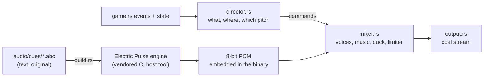

# BRYX audio

The sound of BRYX: what it is, how it is made, and why. Owned by the Audio
Director / Sound Designer role of the [director review](director-review.md);
this closes the review's highest-value open item.

## Identity

BRYX sounds like a sibling of
[Electric Pulse](https://github.com/chussenot/electric-pulse): the same
engine, the same 8-bit dark-synth voice (pulse, triangle and noise
oscillators, ADSR, drive, delay, sidechain). DESIGN.md's "Measured Field"
carries over to sound: precise, synthetic, warm, never a nostalgic replica
of any arcade machine. Every note and loop is original.

Four ideas shape everything below:

1. **The field plays in key.** The music is in E minor. Each brick
   broken in a rally sounds the next note up the E minor pentatonic scale
   (E, G, A, B, D, E…), and the paddle sends it back to the root. A good
   rally plays a phrase over the beat. A bad one plays one note.
2. **Sound sits where it happens.** Every effect is panned, with equal
   power, to its x on the field, three quarters of the way to each
   speaker. This holds in both renderers.
3. **The paddle tightens with the ball.** Its knock rises up to a minor
   third as the ball climbs from 300 to 700 px/s, so the rally's pace is
   heard.
4. **Music follows the campaign.** One loop per act, all on the same
   original eight-bar progression (Em, C, G, D, Em, C, Am, B), each faster
   and fuller than the last:

   | Act | Tempo | Layers |
   |---|---|---|
   | I | 112 BPM | half-time kick, bass, arpeggio, pad |
   | II | 118 BPM | adds hats and a four-on-the-floor kick |
   | III | 124 BPM | swaps the pad for the lead melody |
   | IV | 132 BPM | adds snare, driving bass, a counter-melody |

   Stingers mark the moments (life lost, level cleared, Game Over,
   Victory, 1UP) and duck the loop beneath them.

## How it is built

- **Render at build time, not at runtime.** `build.rs` compiles the
  vendored engine (`audio/engine/`, unmodified, see its PROVENANCE.md) and
  `audio/render.c` into a host tool, then renders each cue to PCM in
  `OUT_DIR`; the binary embeds the bytes. The game runs no C and no
  `unsafe` FFI, needs no audio files beside it, and every build sounds the
  same. A sound is an `.abc` text file: edit it, rebuild, hear it.
- **One renderer, many notes.** Pitch is playback rate, so one rendered
  brick note plays the whole pentatonic scale and one paddle knock every
  speed.
- **Playback through `cpal`**, the backend Electric Pulse chose for direct
  playback (its ADR-0001). It is a device layer only; the mixer is BRYX's
  own, in `src/audio/mixer.rs`:
  - up to 32 voices, the oldest stolen beyond that;
  - music crossfades over 1.2 s;
  - stingers duck the music to 25%;
  - a `tanh` soft limiter, so a burst of breaks never hard-clips.
- **The game thread never blocks on audio.** Commands cross a channel;
  the callback drains it and owns the mixer.
- **Presentation only.** The director reads each tick's events before
  `main.rs` drains them, plus the game's state, exactly as the renderers
  do. Nothing in `src/audio/` can change what happens; the pinned replay
  hash is untouched.

## Cues

| Cue | When | Sound |
|---|---|---|
| `brick` | a brick breaks | pulse pop, pitched up the scale by the rally |
| `armor` | an armored brick cracks | high metallic double tink |
| `paddle` | ball meets paddle | triangle knock and a noise click, pitched by speed |
| `launch` | serve | short rising whip |
| `capsule` | any helpful capsule | quick rising arpeggio with an echo |
| `tiny` | the Tiny capsule | falling, slightly sour arpeggio |
| `oneup` | the Player capsule | a small fanfare; ducks the music |
| `laser`, `superlaser` | a gun fires | a gliding zap; a heavier, buzzing beam |
| `asteroid` | an asteroid arrives | a low noise swell |
| `explosion` | an asteroid blows up | a noise burst over a falling thump |
| `ball_lost` | one ball of a multiball drops | a descending figure |
| `warp` | leaving through the Break gate | a rising sweep |
| `select`, `pause` | start, continue, resume; pause | two-note blips, up and down |
| `life_lost`, `level_clear`, `game_over`, `victory` | stingers | phrases built from the act loops' material |
| `music_menu`, `music_act1`–`4` | loops | see the act table above |

## Mix

| | Level |
|---|---|
| Music | 0.36 under the effects; 0.3 of that while paused; 25% under a stinger |
| Bricks, paddle | 0.6–0.65 |
| Other effects | 0.3–0.7, by importance |
| Master | 1.5 into the soft limiter |

Measured on a 45 s autopilot soundtrack, rendered offline through the
same director and mixer: about -18 dBFS RMS with peaks near -3 dBFS, the
same in acts I and IV, and no sample at full scale.

## Player control and accessibility

- **M** cycles the sound: on, effects only, off. The menu and pause
  screens show the current setting beside the key.
- `BRYX_SOUND=effects` or `BRYX_SOUND=off` sets the starting mode.
- No device (a headless machine) means one warning and a silent game,
  never a crash.
- Every cue has a visual counterpart, so no information is sound-only.

## Building

- The default `audio` feature needs a C compiler (any `cc` finds), and on
  Linux the ALSA headers (`libasound2-dev`); CI installs them.
- `--no-default-features` builds a silent game with neither.

## Open

- **Spatial depth.** Sound is panned left to right only. In the 3D
  renderer, a little low-pass for the far side of the field would add
  depth.
- **Music variation within an act.** Each act loops one 15–17 s track.
  The engine's jam generator could vary it; that was not vendored.
- **A listening pass.** Every level and loudness figure here was measured
  in a headless environment with no speakers. Please play it on real
  speakers and headphones; the mix constants live in `mixer.rs` and
  `director.rs`.
